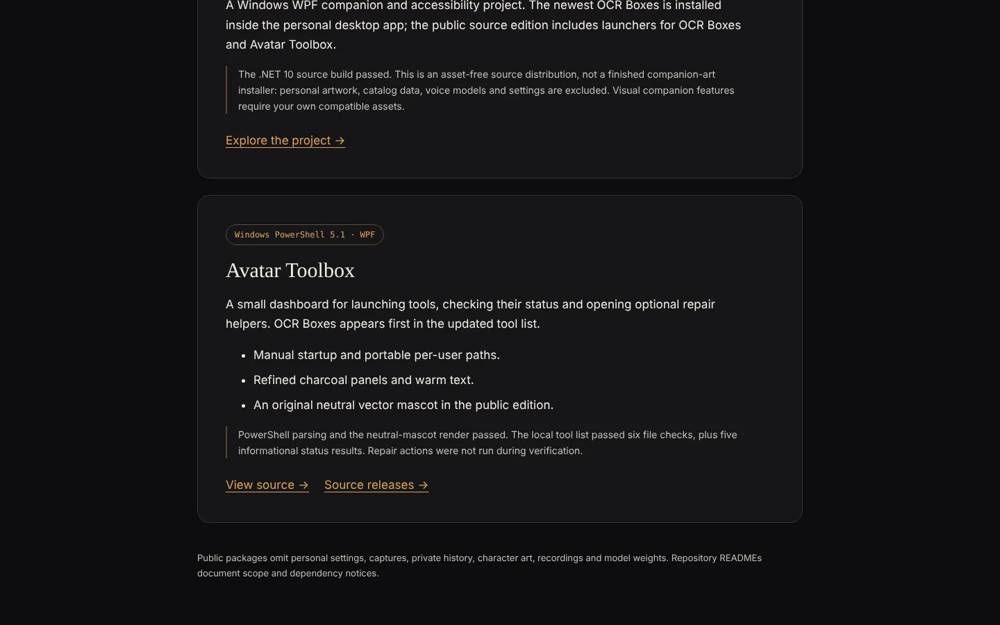
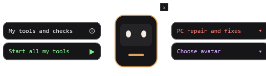

# Avatar Toolbox

**A small Windows dashboard for launching your tools and checking their status.**

[**▶ Project page on caseyshingledecker.com**](https://caseyshingledecker.com/desktop-tools.html#avatar-toolbox) · [**Source**](https://github.com/Beebopcat/avatar-toolbox)



## What it is

A small Windows PowerShell 5.1 / WPF dashboard for launching tools, checking their status and opening optional repair helpers. OCR Boxes is first in the tool list.

## Screenshots


<sub>Desktop Tools page at the Avatar Toolbox card, with its feature list and View source and Source releases links.</sub>



<sub>Preview of the public edition (`preview.png`): the original neutral vector mascot.</sub>

## How to use

1. Run `powershell.exe -NoProfile -STA -File Avatar-Toolbox.ps1`. Nothing starts automatically in the supplied configuration.
2. Edit `tools.json` to list your own tools (fields: id, name, info, hotkeys, kind `ahk`/`python`/`service`, path or exe and args, healthUrl and stopUrl, log, autostart).
3. To change the generated script, edit the templates `source/hub.template.ps1` and `source/repair.template.ps1`, then rebuild with `python source/build_toolbox.py`.
4. Review each repair action and its confirmation before using it; repairs can change Windows settings.

## Features

- Start and stop controls plus read-only status checks for each tool
- Optional repair helpers
- An avatar picker; the public edition uses an original neutral vector mascot when no avatar artwork is installed
- Manual startup and portable per-user paths
- Charcoal panels with cream, warm text matching Kokoro Player

## The story behind it

The public edition is dated 2026-10-20. It derives from a personal always-on-top toolbox widget that combined the author's tools with automated checks, repairs and a companion picker; the public edition swaps in a neutral mascot. OCR Boxes is first in the tool list, and its path resolves to the copy bundled with Desktop Pixel Companions; change it if you installed OCR Boxes elsewhere.

## Built with

- PowerShell 5.1
- WPF
- Python (`build_toolbox.py` generator)
- `tools.json` configuration

## Run it locally

Requires Windows with PowerShell 5.1.

```powershell
git clone https://github.com/Beebopcat/avatar-toolbox.git
cd avatar-toolbox
powershell.exe -NoProfile -STA -File Avatar-Toolbox.ps1
```

## Validation and scope

The local edition passed PowerShell parsing and six file-presence checks, with five informational status results and no failures. These checks do not validate every repair action. No repair, service restart or audio playback was performed as part of release preparation.

## Credits & disclaimers

Original project source is published for inspection; no additional source license or third-party character-art rights are granted by this repository. Personal character art, settings, reports and voice models are excluded.

Built by Casey Shingledecker with AI-assisted development.

## More projects

- Portfolio and live demos: https://caseyshingledecker.com/
- All repositories: https://github.com/Beebopcat
